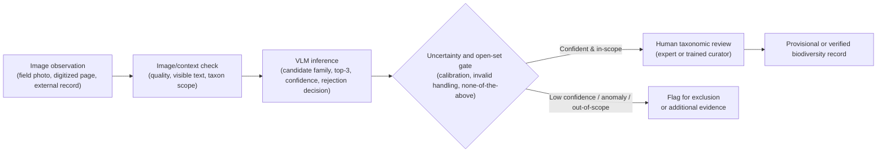

# Auditing General-Purpose Vision-Language Models for Fern Identification in Ecological Informatics: Closed-Set Accuracy, Open-Set Rejection, and Cross-Source Generalization

## Abstract

General-purpose vision-language models (VLMs) are increasingly promoted as flexible image-understanding systems that can describe images, classify objects, extract visible text, and answer visual questions without task-specific training. This flexibility could make them attractive components of ecological-informatics workflows, but their reliability for specialist plant taxonomy remains uncertain. We audited five contemporary VLMs for fern identification using a benchmark derived from 155 research-only reference images spanning 30 project families, together with supplementary tests designed to reflect deployment risks. API-based experiments were conducted between 9 and 12 May 2026. The main experiments included direct 30-family closed-set classification, taxonomy-structured prompting, an L3 subset, and a 39-species Polypodiaceae task. We further evaluated text masking, candidate-order perturbation, external validation on iNaturalist/GBIF images, open-set rejection, macro/balanced accuracy, error types, confidence calibration, and genus-level collapse.

The models showed non-random but limited family-level performance. In the main 30-family direct task, the best family accuracy was 60.6% for Qwen3.5-397B-A17B, closely followed by Gemini 3.1 Flash Lite at 59.4%; paired tests did not support strong leaderboard-style claims among the leading models. Taxonomy-structured prompting did not produce a stable improvement. Species-level accuracy was near zero (0%-2.6%), and genus-level collapse remained weak (5.1%-7.7%). External validation accuracy dropped to 33.3%-43.3%, indicating limited cross-source generalization. Open-set negative rejection reached 73.3%-91.7%, but positive in-scope family accuracy remained only 40.0%-46.7%. Confidence analysis revealed substantial high-confidence errors. These results suggest that current general-purpose VLMs can support coarse candidate generation and triage, but they should be treated as provisional, human-reviewed workflow components rather than autonomous fern identifiers.

**Keywords:** vision-language models; fern identification; ecological informatics; biodiversity informatics; plant taxonomy; open-set recognition; confidence calibration

## 1. Introduction

Accurate plant identification is a foundational task in biodiversity monitoring, ecological research, conservation planning, and the construction of digital floras. Image-based tools have already changed how plant observations are collected and annotated, especially in citizen-science platforms and biodiversity databases (Joly et al., 2014; Mäder et al., 2021; Popp et al., 2025). More broadly, machine learning is increasingly used to reduce manual annotation effort in ecological monitoring, including camera-trap, acoustic, and plant-community image workflows (Kahl et al., 2021; Tuia et al., 2022). Nevertheless, reliable taxonomic identification remains difficult for many plant groups because diagnostic characters are often subtle, seasonal, scale-dependent, or absent from casual photographs (Wäldchen et al., 2018; Garcin et al., 2021).

Recent general-purpose VLMs have been marketed and documented as broadly capable image-understanding systems. Major model platforms and technical reports describe multimodal models as supporting tasks such as image captioning, object recognition, image classification, visual question answering, OCR-like text extraction, structured output from images, and image-grounded reasoning without training a new task-specific classifier (OpenAI, 2023; Gemini Team, 2024; Bai et al., 2025). General VLM benchmarks also show rapid progress in multimodal instruction following and expert-level visual reasoning, while revealing persistent issues in perception, robustness, and evaluation coverage (Fu et al., 2023; Yue et al., 2024). This broad capability claim is important for ecological informatics because it suggests that the same model could potentially be inserted into biodiversity workflows as a flexible image interpreter, candidate generator, or triage assistant. In contrast to traditional plant-recognition systems trained on a fixed taxonomic dataset, prompt-based VLMs can be given candidate taxa, diagnostic cues, JSON output constraints, and open-set options at inference time.

However, there is a gap between general image understanding and professional plant classification. Consumer-facing or general API demonstrations often emphasize visually salient objects, scene descriptions, product information, document understanding, or common-category classification. Botanical taxonomy is different: correct identification may depend on small structures, life stage, organ visibility, microscopic or near-microscopic traits, and specialist terminology. A VLM may recognize that an image contains a fern-like plant yet still confuse families, genera, or species because the decisive characters are not visible, not represented in pretraining data, or not emphasized during post-training. The same model may also rely on page text, be attracted to common taxa, fail to obey a closed candidate list, or generate confident but taxonomically incorrect answers. These issues are especially important in biodiversity applications where errors may propagate into occurrence records, ecological assessments, and conservation decisions.

Existing image-based plant identification research can be grouped into three related but distinct traditions: dedicated visual classifiers, curated training and benchmark datasets, and application-centered recognition systems. The first tradition treats plant identification as a task-specific computer-vision problem. Early systems such as Leafsnap combined leaf segmentation, contour-based shape features, and species retrieval within a fixed set of tree species (Kumar et al., 2012). Later studies increasingly adopted convolutional neural networks, transfer learning, multi-view classification, and organ-specific recognition. Reviews of automated plant species identification emphasize that this shift from hand-crafted features to deep learning substantially improved performance, but did not remove the biological difficulty of the task: plant images vary across organs, seasons, developmental stages, acquisition conditions, and closely related taxa can differ only in small or cryptic structures (Wäldchen et al., 2018). In this literature, the central methodological object is usually a classifier trained or optimized for a defined taxonomic scope, often using leaves, flowers, fruits, bark, habit images, or multi-organ observations as input.

The second tradition is the construction of curated or semi-curated datasets and benchmark challenges. PlantCLEF and LifeCLEF progressively moved plant identification from small leaf datasets toward larger and more realistic biodiversity-monitoring scenarios. For example, LifeCLEF 2015 evaluated plant identification on more than 100,000 images representing approximately 1,000 plant species, including observation-level queries in which several images of the same individual plant could be combined (Goëau et al., 2015). LifeCLEF 2017 further expanded the scale toward approximately 10,000 species and 1.1 million images, explicitly testing how deep learning methods could exploit trusted and noisy web data (Goëau et al., 2017). More recent PlantCLEF challenges have further emphasized global-scale identification, multi-species vegetation plots, open-world class imbalance, and heterogeneous image sources (Joly et al., 2025; Goëau et al., 2025). Pl@ntNet-300K later formalized key dataset-level problems for plant recognition, including strong class imbalance, high label ambiguity, and visual similarity among species, using 306,146 images from 1,081 species (Garcin et al., 2021). iNaturalist-based datasets and geographical priors have also become important for fine-grained biodiversity recognition, because species identity is often constrained by spatial context as well as visual traits (Van Horn et al., 2018; Mac Aodha et al., 2019). These resources are essential for algorithmic progress, but they also show that plant identification accuracy is inseparable from data design: taxonomic coverage, class balance, label verification, organ visibility, image context, and candidate-set definition all shape the meaning of a reported score.

The third tradition is application-centered plant identification. Pl@ntNet was designed as a citizen-science and ecological-monitoring workflow in which user-submitted, geo-referenced, multi-organ plant photographs are connected to image retrieval, model prediction, and community validation (Joly et al., 2014). Flora Incognita similarly combines automated recognition with an interactive mobile workflow that asks users for plant images and returns ranked identification suggestions with additional species information (Mäder et al., 2021). More recent ecological-informatics work evaluates plant identification services in biodiversity-monitoring settings, including how taxonomic resolution, geographic scope, and photographed plant parts affect performance (Popp et al., 2025). Related Ecological Informatics studies have also shown how large plant-recognition models and web tools can be adapted to invasive-plant detection and single-image or multi-image species identification (Espitalier et al., 2025; Körschens et al., 2025). App-evaluation studies further show that phone-based plant identification can be useful but uneven: performance varies across applications, plant groups, image quality, and risk setting, and some studies warn against relying on applications for high-stakes contexts such as edible or toxic plant identification (Campbell et al., 2023; Hart et al., 2023; Long et al., 2023; Rzanny et al., 2024). These application studies are particularly relevant because they evaluate tools as deployed workflows rather than as isolated algorithms.

A newer line of plant-related multimodal research has begun to use vision-language models or multimodal large language models, but much of it remains concentrated in agricultural and plant-pathology settings. Recent studies have built VLM-oriented resources for plant disease visual question answering and domain-specific multimodal assistants for agricultural decision support, such as PlantVillageVQA and AgroGPT (Awais et al., 2025; Sakib et al., 2025). This emerging work builds on the broader shift toward language-supervised and instruction-following visual models (Radford et al., 2021; Li et al., 2023; Liu et al., 2024; Gemini Team, 2024; Bai et al., 2025), and confirms that plant science is beginning to move beyond pure image classification toward image-plus-text reasoning. However, these studies usually construct specialized datasets, tune domain-specific models, or focus on crop pathology rather than testing off-the-shelf general-purpose VLMs as taxonomic decision components in biodiversity data workflows.

These lines of work have produced substantial progress, but they differ from the setting evaluated here. Most prior plant-identification systems either train or fine-tune a task-specific classifier on a fixed taxonomic scope, rely on manually curated or semi-curated image-label corpora, or operate inside an application workflow designed for a particular flora, region, observation protocol, or citizen-science platform. General-purpose VLMs instead provide a prompt-based interface: the same model can be given candidate taxa, morphological cues, output schemas, and rejection options without being retrained for the target plant group. This flexibility is attractive for ecological informatics, but it also creates an unresolved validation problem. It remains unclear whether contemporary general-purpose VLMs can provide reliable family-level candidate suggestions, whether larger model variants consistently outperform smaller or more efficient variants, whether taxonomy-informed prompts improve classification, whether predictions are stable under candidate-list perturbation, whether self-reported confidence is meaningful, and whether VLMs can reject out-of-scope organisms rather than forcing every image into a closed candidate set. This is the main empirical gap addressed by the present study.

We use ferns as the focal taxonomic group for three reasons. First, ferns are morphologically informative but taxonomically challenging: family- and species-level identification often relies on frond architecture, venation, rhizomes, scales, sori, sporangia, and other features that require botanical expertise. Second, many fern specimens are relatively compact in photographic representation, so a single image can often contain multiple potentially useful characters, making the group suitable for testing whether VLMs can extract morphology from one image. Third, ferns include many visually similar lineages, which makes them a strong stress test for distinguishing coarse visual recognition from taxonomically meaningful identification.

This study evaluates the capability boundaries of general-purpose VLMs for fern identification. We compare five VLMs across family-level and species-level closed-set tasks, then extend the evaluation with supplementary experiments designed to reflect ecological-informatics deployment risks. Specifically, we addressed the following research questions:

1. What level of family-level accuracy do contemporary VLMs achieve in a 30-family closed-set fern classification task, and are apparent model differences supported by paired statistical tests?
2. Does taxonomy-structured prompting improve family-level classification relative to a direct closed-set prompt?
3. Does fine-grained failure persist when species-level predictions are collapsed to genus level?
4. How robust are model predictions to visible-text masking and candidate-order perturbation?
5. How well do VLMs generalize to external iNaturalist and GBIF-derived images?
6. Can VLMs reject out-of-scope images in an open-set fern-identification setting?

We argue that the value of this evaluation is not a simple model leaderboard. Instead, the central contribution is an evidence chain showing where general-purpose VLMs can assist fern identification and where they remain unsafe for autonomous taxonomic deployment.

The intended ecological-informatics interpretation is a workflow audit rather than a replacement claim. In a practical biodiversity-image pipeline, VLM outputs would be only one intermediate signal between raw image observations and verified ecological records:

This framing motivates the evaluation design: closed-set accuracy tests candidate generation, text masking and candidate-order perturbation test prompt robustness, external validation tests cross-source generalization, open-set rejection tests scope control, and confidence analysis tests whether model self-reports can support human-in-the-loop triage.

**[Insert Figure 1 here.]**

## 2. Materials and Methods

### 2.1 Dataset and taxonomic scope

The main evaluation used a local research-only evaluation dataset derived from *中国高等植物彩色图鉴* volumes 1 and 2. The dataset was constructed from digitized reference pages rather than downloaded as a ready-made machine-learning benchmark. The construction workflow combined page-level image extraction, plant-photo region extraction, text-field extraction, and taxonomic standardization. First, source pages from the PDF/reference material were converted into page images and candidate image regions were extracted from the page layout. The image directory retains both full-page context images and cropped image-box files; file names preserve page numbers and image-box coordinates, for example `page_2_img_in_image_box_339_107_694_573.jpg`. Second, accompanying text was parsed into structured species records, including Chinese species name, Latin binomial, family name, morphology, distribution, and habitat. Third, species records were linked to one representative image reference and normalized into the project schema. Finally, family labels and Latin family names were standardized against the project canonical taxonomy used in the analysis scripts.

The resulting working image directory contains 912 JPEG files, including 797 cropped image-box files and 115 full-page images. The final evaluation manifest selected 155 species-level records, each with one image reference. Among these 155 evaluated image references, 115 were full-page or page-context images and 40 were cropped plant-photo images. This structure reflects the original reference-book layout: some taxa were represented most reliably by page-context images, whereas others had usable cropped image boxes. Because page-context images may include visible labels, captions, or surrounding text, the study explicitly included a text-masked robustness experiment rather than assuming that all local images were purely photographic.

The dataset manifest records 155 species-level entries across 30 project family labels. Each record contains a `species_id`, Chinese species name, Latin binomial, Chinese family label, Latin family label, morphology, distribution, habitat, and one local image reference. The family distribution was strongly imbalanced: the largest two families were Dryopteridaceae-like `鳞毛蕨科` with 43 records and Polypodiaceae `水龙骨科` with 39 records, whereas several families had only one or two records.

Labels were treated as source-standardized labels. Species and family names were derived from the source reference and normalized to the project canonical taxonomy and alias table used by the analysis scripts. We do not claim independent expert re-identification of every image. This conservative wording is important because the benchmark evaluates VLM behavior against a standardized reference dataset rather than establishing a new taxonomic authority.

The local images were used only for internal computational evaluation and are not redistributed with the manuscript or supplementary files. Releasable materials are limited to metadata, code, prompts, raw/standardized model outputs where allowed, and derived tables. Because full-page images may include visible page text or labels, we explicitly evaluated a text-masked subset rather than assuming that the local benchmark is text-free.

The extracted textual fields were used in two different ways. The image-only closed-set experiments used the images and candidate family lists, while taxonomy-prompted and species-level prompts could include structured taxonomic context derived from the parsed morphology and family metadata. The same structured records also made it possible to construct canonical candidate lists, map predicted species to genus level, and audit family imbalance. Thus, the dataset construction was not only image collection; it also produced a linked image-text-taxonomy table that supported the later prompt design and error analysis.

### 2.2 Evaluated vision-language models

Five general-purpose VLMs were evaluated in the main experiments. The API-based experiments were conducted between 9 and 12 May 2026, and should therefore be interpreted as a time-stamped evaluation of provider-hosted systems that may change after deployment. The model set was selected to cover provider diversity, approximate parameter scale, architectural design, and practical API deployment rather than to produce a definitive public leaderboard. The Qwen-series models are reported uniformly under DashScope as the access route, and Gemini 3.1 Flash Lite is reported under Google AI Studio. Where vendors expose only limited architectural details, model scale and structure are described according to public model names and provider-facing identifiers rather than independently verified internal architecture.

| Reported model label | Access route | Approximate scale / architecture | Selection rationale |
|---|---|---|---|
| mimo-v2.5 | Mimo | General-purpose VLM; parameter scale not independently verified in this study | Retained as the initial baseline pipeline to anchor the later multi-model comparison |
| Qwen3.5-397B-A17B | DashScope | Large Qwen-family sparse/activated-parameter model; reported family scale 397B total / A17B activated | Tests whether substantially larger nominal capacity improves specialist fern taxonomy under the same closed-set prompts |
| Qwen3.5-27B | DashScope | Mid-sized Qwen-family dense model at the 27B scale | Provides a dense-model comparison point near the smaller Qwen scale and supports exploratory dense-versus-MoE interpretation |
| Qwen3.5-35B-A3B | DashScope | Qwen-family sparse/MoE-style model; reported family scale 35B total / A3B activated | Tests a more cost-efficient activated-parameter model and enables comparison with the 27B dense model |
| Gemini 3.1 Flash Lite | Google AI Studio | Lightweight Gemini-family multimodal model; exact parameter count not publicly specified | Adds a non-Qwen provider family and represents an efficient general-purpose image-plus-text API setting |

This selection allowed the study to ask whether practical differences in provider family, model scale, and dense versus sparse/MoE-style design translate into meaningful improvements for fern identification. The comparison should be interpreted operationally: it evaluates the behavior of API-accessible VLM systems under a checkpointed prompt-and-image workflow, not a controlled mechanistic ablation of model architecture. For the supplementary deployment-oriented experiments, three core models were used: Qwen3.5-35B-A3B, Qwen3.5-397B-A17B, and Gemini 3.1 Flash Lite. These models retained the main contrast between a large Qwen-family system, a smaller activated-parameter Qwen-family system, and a different provider family while keeping the additional API workload manageable.

All model calls used image-plus-text chat messages and requested structured JSON outputs. Temperature was set to `0.0`. API keys were supplied outside the manuscript workflow and were not written into scripts, tables, or result files intended for release. Each sample was saved immediately after inference, including raw response text or JSON, parsed fields, model identifier, timing information when available, and completion state. Failed calls, empty outputs, unparsable outputs, and candidate-out selections were retained for scoring as invalid rather than removed.

| Model label | Model identifier(s) recorded during runs | Access route reported in manuscript | Inference and audit settings |
|---|---|---|---|
| mimo-v2.5 | `mimo-v2.5` | Mimo | Image-plus-text inference with structured JSON requested; temperature 0.0 where configurable; max output tokens 2200 in the main runner; raw response and parsed fields retained |
| Qwen3.5-397B-A17B | `qwen3.5-397b-a17b`; `qwen3.5-plus`; `qwen3.5-plus-2026-02-15`; `Qwen/Qwen3.5-397B-A17B` | DashScope | OpenAI-compatible multimodal chat; temperature 0.0; max output tokens 900; image long side 2048 in main runs and 1536 in supplementary runs; fallback aliases recorded for traceability |
| Qwen3.5-27B | `Qwen/Qwen3.5-27B` | DashScope | OpenAI-compatible multimodal chat; temperature 0.0; max output tokens 900; image long side 2048 in main runs; raw response, normalized prediction, invalid status, timing, and state information retained |
| Qwen3.5-35B-A3B | `qwen3.5-flash`; `qwen3.5-flash-2026-02-23`; `Qwen/Qwen3.5-35B-A3B` | DashScope | OpenAI-compatible multimodal chat; temperature 0.0; max output tokens 900; image long side 2048 in main runs and 1536 in supplementary runs; aliases treated as the same reported model for analysis and checkpointing |
| Gemini 3.1 Flash Lite | `gemini-3.1-flash-lite` | Google AI Studio | OpenAI-compatible multimodal chat; temperature 0.0; max output tokens 900; image long side 1536 in supplementary runs; raw response, parsed fields, invalid status, timing, and state information retained |

Prompt templates, candidate lists, output schemas, and normalization rules will be released with the analysis code and derived results. Because the evaluated systems are API-based and may change over time, the results should be interpreted as a checkpointed evaluation instance supported by archived raw responses, standardized outputs, prompts, model identifiers, and state files.

### 2.3 Main closed-set task design

The main experiments were designed as closed-set tests rather than open-ended identification. In each run, the model received one image and an explicit candidate list, and it was required to return a structured JSON object. This design was chosen because many ecological-informatics workflows do not ask a model to name any possible organism in the world; instead, they often apply a regional flora, a project checklist, or a database-derived candidate set before expert review. The closed-set design therefore tested whether VLMs could select among known fern candidates under controlled task constraints.

Four closed-set tasks were evaluated. The first three operated at family level using the same 30 project families; the fourth operated at species level within Polypodiaceae. All five VLMs were evaluated on all four tasks, yielding 2,020 main model-sample predictions before supplementary experiments.

| Task ID | Taxonomic target | Images / candidates | Input context given to model | Required output | Primary metric | Purpose |
|---|---|---:|---|---|---|---|
| `direct30_full155` | Family | 155 images; 30 candidate families | Image plus numbered family list only | `selected_option`, `top3`, `confidence`, `reasoning` | Family accuracy; top-3 family accuracy | Main closed-set family benchmark |
| `taxonomy_l3` | Family | 55-image L3 subset; 30 candidate families | Image plus candidate family list with Latin family names, broad group labels, and example species | `selected_option`, `top3`, `confidence`, `visible_features`, `missing_evidence`, `reasoning` | Family accuracy; top-3 family accuracy | Test whether taxonomy-structured prompting changes performance on a smaller balanced subset |
| `taxonomy_full155` | Family | 155 images; 30 candidate families | Same taxonomy-structured prompt as `taxonomy_l3` | Same as `taxonomy_l3` | Family accuracy; top-3 family accuracy | Test taxonomy-structured prompting on the full local dataset |
| `species_l4` | Species | 39 Polypodiaceae images; 39 candidate species | Image plus candidate species list with Chinese name, Latin binomial, family, and short morphology excerpt | `selected_species`, `top3_species`, `selected_family`, `confidence`, `reasoning` | Species accuracy; species top-3 accuracy | Stress test fine-grained species-level recognition within one family |

In `direct30_full155`, each of the 155 local evaluation records was presented once to each model. The prompt supplied only the 30 canonical Chinese family names and instructed the model to choose the most likely family even when visual evidence was incomplete. This task served as the main family-level benchmark because it minimized additional taxonomic hints beyond the candidate list.

The taxonomy-prompted tasks used the same 30 family labels but added structured taxonomic context to the prompt. For each family, the prompt included the Chinese family name, Latin family name, a broad project group label, and up to two example species from the local dataset. The prompt also directed the model to consider life form, leaf division, leaf texture, petiole or rhizome characters, and the position and shape of sori when visible. The examples were intended to define the output space and taxonomic context, not to imply that the test image belonged to one of the listed example species. `taxonomy_l3` used a 55-image subset covering all 30 families, with one to three samples per family, to preserve continuity with earlier hierarchical experiments while reducing API cost. `taxonomy_full155` applied the same taxonomy-structured prompt to all 155 records, allowing direct comparison with `direct30_full155` on the full dataset.

The species-level task, `species_l4`, used the 39 local records whose source-standardized family was Polypodiaceae (`水龙骨科`). All 39 candidate species were supplied in the prompt with Chinese names, Latin binomials, family labels, and truncated morphology descriptions. This task intentionally removed family-level ambiguity by restricting all candidates to one family, so a correct family prediction alone was not considered evidence of species-level identification. The primary endpoint was exact species match, with top-3 species hit and later genus-level collapse used as secondary analyses.

For every task, the candidate list was closed. A prediction was counted as correct only when the normalized selected family or species exactly matched the expected source-standardized label. For family tasks, `top3` was counted as correct if the expected family appeared among the normalized top three candidates. For the species task, `top3_species` was evaluated analogously. Empty answers, unparsable JSON, null selections, and selections outside the candidate list were retained in the denominator and marked invalid rather than removed.

Prompt templates were versioned together with the analysis workflow and will be released with the reproducibility materials where allowed by provider terms.

### 2.4 Text-masked robustness experiment

To test whether model performance depended primarily on visible page text or labels, we constructed a 60-image text-masked subset from the local fern dataset. The subset covered all 30 candidate families, with one to seven samples per family depending on availability in the local dataset. For each selected record, the original image was copied into the text-masked workflow. Candidate text regions were detected with OCR-based hOCR parsing, low-confidence or oversized detections were filtered to reduce accidental masking of plant structures, and retained boxes were covered with light rectangles while preserving the fern photograph as much as possible. The manifest recorded `species_id`, source image, source type, original image path, masked image path, number of text boxes, and masked-area ratio.

Three core models were evaluated on this subset: Qwen3.5-35B-A3B, Qwen3.5-397B-A17B, and Gemini 3.1 Flash Lite. Each model was run under both the direct 30-family prompt and the taxonomy-structured 30-family prompt. For paired comparison, the corresponding original-image results were extracted from the same 60 records in the completed full-set experiments. The analysis compared original versus masked conditions using family accuracy, top-3 accuracy, invalid rate, exact paired McNemar tests, and bootstrap confidence intervals for paired accuracy differences. Because the paired test was based on 60 images, the text-masking experiment had limited statistical power; only relatively large paired effects would be expected to be detected reliably.

### 2.5 Candidate-order robustness experiment

Closed-set VLM predictions may depend on the order in which candidate labels are shown in the prompt. To evaluate this sensitivity, the same 60 text-masked images were evaluated with the direct 30-family prompt under three shuffled candidate orders using seeds `20260512`, `20260513`, and `20260514`. The image set, model set, prompt instruction, output schema, and scoring rules were otherwise held constant. The original-order text-masked direct task served as the baseline. We measured accuracy, top-3 accuracy, invalid rate, consistency of the selected family relative to the original-order prediction, per-sample prediction entropy across shuffled orders, and candidate-position bias.

### 2.6 External validation dataset

An external validation set was constructed from iNaturalist and GBIF-derived images to test cross-source generalization. It contained 90 images, with three external images for each of the 30 candidate fern families. This density was chosen to preserve complete 30-family coverage while keeping the additional API workload tractable. The external set was therefore designed primarily to estimate overall cross-source generalization and identify broad failure patterns, not to support definitive per-family statistical comparisons. Per-family external results were treated as exploratory because each family contributed only three images. The collection prioritized research-grade iNaturalist photographs and used GBIF records as supplementary sources when suitable iNaturalist records were unavailable. For each project family, searches were guided by representative species or genera from `species_data.json` rather than relying only on broad family-level pulls, because family names and taxonomic circumscriptions are not always perfectly aligned across databases.

The external manifest stored sample ID, project family, project Latin family, query taxon, returned taxon name and rank, source database, source record ID, photo ID, source URL, image URL, local image reference, license, rights holder, image context, image dimensions, SHA-1 hash, and a flag indicating whether the image license was suitable for display in a paper figure. The final manifest contained 72 iNaturalist images and 18 GBIF images. These sources were used because they are widely used biodiversity-data infrastructures, but their records also inherit platform-specific sampling, licensing, and label-verification constraints (GBIF Secretariat, 2023; iNaturalist, 2024). External validation was evaluated only with the direct 30-family prompt for the three core models, so the experiment isolated source shift while keeping the candidate set and output schema consistent with the main family-level task.

### 2.7 Open-set rejection experiment

The open-set dataset was designed to test whether a model could avoid forcing every image into one of the 30 project families. It contained 120 images: 60 in-scope positives from the text-masked fern subset and 60 out-of-scope negatives from external sources. The positive images were drawn from the masked subset to avoid allowing visible page labels or captions to make the retention task artificially easy and to keep the positive set aligned with the robustness experiments. This design may underestimate positive family accuracy relative to original unmasked images, but it provides a stricter test of whether in-scope ferns are retained when text cues are reduced. The negative images were divided into four groups with 15 images each: candidate-out fern or lycophyte-like taxa, angiosperms, gymnosperms/cycads, and bryophytes/liverworts. This grouping separated obvious non-ferns from visually closer fern-like negatives that better represent realistic deployment risk.

The open-set prompt retained the 30 candidate families but added two allowed non-family decisions: `none_of_the_above` and `uncertain`. A positive image was considered retained when the model returned an in-scope family decision; it was considered family-correct only when the selected family matched the expected family. A negative image was considered correctly rejected when the model returned `none_of_the_above` or `uncertain`. A negative image assigned to any candidate family was counted as a false positive. We measured negative rejection accuracy, false positive rate, positive retention accuracy, positive family accuracy, invalid decisions, and high-confidence false positives using a confidence threshold of 0.8.

### 2.8 Output normalization and invalid handling

All model outputs were normalized against canonical family and species labels before scoring. The normalization procedure parsed JSON directly when possible and otherwise attempted to extract a JSON object from fenced code blocks or surrounding text. Candidate aliases, numbering artifacts, Latin-name parentheticals, and known family-name variants were mapped to the project canonical taxonomy where unambiguous. For family-level tasks, `selected_option` was the primary selected label and `top3` was the top-3 label list. For the species task, `selected_species` and `top3_species` were used, with `selected_family` retained for diagnostic analysis but not treated as species correctness.

Outputs were marked invalid when the selected taxon was empty, outside the candidate set, not parseable into the expected field, or mapped only to an out-of-vocabulary label. Invalid outputs were retained in denominators and reported as invalid rates. This choice reflects a practical deployment perspective: a model that fails to produce a usable closed-set answer still contributes to system-level failure. The same invalid-handling rule was applied across main, text-masked, candidate-order, external-validation, and open-set experiments.

### 2.9 Baseline comparisons

To contextualize the closed-set results, we calculated three non-API baselines for the 30-family direct task. A uniform random top-1 guess has expected accuracy of 1/30, or 3.3%. A uniform random top-3 guess has expected hit rate of 3/30, or 10.0%, assuming three distinct randomly selected families. A majority-family baseline always predicts the most frequent local family, `鳞毛蕨科`, yielding 43/155 correct predictions, or 27.7%. These baselines are not intended as competitive identification systems; they provide lower-bound context for interpreting whether VLMs extract non-trivial visual or prior taxonomic signal.

### 2.10 Statistical analysis

We report accuracy, top-3 accuracy, invalid rate, token use, and average response time. Family accuracy was calculated as the number of family-correct predictions divided by all evaluated samples, including invalid outputs. Species accuracy was calculated analogously for exact species matches. Wilson 95% confidence intervals were calculated for binomial accuracy estimates. Paired model comparisons used exact McNemar tests on per-sample correctness vectors and bootstrap confidence intervals for paired accuracy differences, using 5,000 bootstrap resamples with fixed random seeds in the analysis scripts.

Because the local dataset was imbalanced across families, micro accuracy was supplemented with macro and balanced family accuracy. Per-family recall was calculated for each model and task, and family-size groups were used to compare rare and common families. Error analysis categorized failures into candidate-out invalid outputs, dominant-family attraction, same broad-group confusion, broader group confusion, missing key morphology, page-text or label cue use, and high-confidence errors.

Confidence calibration was assessed by parsing reported confidence values from raw responses, converting percentage-like values to a 0-1 scale when necessary, and calculating reliability bins, expected calibration error, and high-confidence error rates. Because modern neural networks and multimodal systems can be miscalibrated even when their predictions appear confident, calibration was treated as a deployment-risk analysis rather than a purely descriptive statistic (Guo et al., 2017; Geng et al., 2020). A threshold of confidence >= 0.8 was used for high-confidence error summaries. Species-level predictions were further collapsed to genus level using Latin binomials to test whether species-level failure persisted at a higher taxonomic rank.

## 3. Results

### 3.1 Main family-level closed-set performance was moderate

Across the five VLMs, family-level closed-set classification reached only moderate accuracy. In the main direct 30-family task (`direct30_full155`), Qwen3.5-397B-A17B achieved the highest family accuracy at 60.6% (95% CI: 52.8%-68.0%), followed closely by Gemini 3.1 Flash Lite at 59.4% (51.5%-66.8%), Qwen3.5-27B at 57.4%, Qwen3.5-35B-A3B at 56.8%, and mimo-v2.5 at 51.0%.

| Model | Direct30 family acc | Taxonomy full family acc | L3 family acc | Species acc | Invalid pattern |
|---|---:|---:|---:|---:|---|
| mimo-v2.5 | 51.0% | 40.6% | 20.0% | 2.6% | low but present invalid outputs |
| Qwen3.5-397B-A17B | 60.6% | 59.4% | 43.6% | 2.6% | low invalid rate |
| Qwen3.5-27B | 57.4% | 59.4% | 36.4% | 2.6% | no invalid outputs in most tasks |
| Qwen3.5-35B-A3B | 56.8% | 59.4% | 34.5% | 2.6% | no invalid outputs in most tasks |
| Gemini 3.1 Flash Lite | 59.4% | 57.4% | 41.8% | 0.0% | no invalid outputs in main family tasks |

Because the local dataset was strongly imbalanced, micro accuracy alone overstates the reliability of family-level recognition. In the direct 30-family task, macro and balanced family accuracy were much lower than micro accuracy: 24.8% for mimo-v2.5, 30.0% for Qwen3.5-27B, 29.5% for Qwen3.5-35B-A3B, 34.1% for Qwen3.5-397B-A17B, and 35.8% for Gemini 3.1 Flash Lite. The best micro-accuracy model was therefore not the best macro-accuracy model, and equal family weighting reduced the apparent performance of all systems.

| Model | Direct30 micro acc | Macro / balanced acc | Rare-family macro acc | Common-family macro acc |
|---|---:|---:|---:|---:|
| mimo-v2.5 | 51.0% | 24.8% | 26.5% | 47.1% |
| Qwen3.5-397B-A17B | 60.6% | 34.1% | 32.4% | 58.2% |
| Qwen3.5-27B | 57.4% | 30.0% | 26.5% | 51.5% |
| Qwen3.5-35B-A3B | 56.8% | 29.5% | 26.5% | 53.9% |
| Gemini 3.1 Flash Lite | 59.4% | 35.8% | 29.4% | 53.4% |

Against trivial baselines, all VLMs extracted non-random family-level signal. The expected random 30-family top-1 accuracy was 3.3%, expected random top-3 accuracy was 10.0%, and the majority-family baseline was 27.7% by always predicting `鳞毛蕨科`. The best VLM top-1 accuracy of 60.6% was therefore well above trivial baselines, but still far below a reliability level suitable for autonomous ecological records.

| Entry | Direct30 family acc | Top-3 acc | Note |
|---|---:|---:|---|
| Random 30-family top-1/top-3 | 3.3% | 10.0% | uniform random candidate choice |
| Majority-family baseline (`鳞毛蕨科`) | 27.7% | not applicable | always predicts the most common local family |
| Best VLM point estimate | 60.6% | 71.0% | Qwen3.5-397B-A17B |

**[Insert Figure 2 here.]**

The absolute differences among the strongest models were small. Qwen3.5-397B-A17B exceeded Gemini by only 1.3 percentage points on the direct full-set task, and their paired comparison was not significant (McNemar exact p = 0.753906; bootstrap difference: -1.3 percentage points for Gemini minus Qwen3.5-397B-A17B, 95% CI: -5.2 to 2.6 percentage points). Thus, although Qwen3.5-397B-A17B had the highest point estimate, the results do not support a strong leaderboard-style claim among the leading models.

**[Insert Figure 3 here.]**

### 3.2 Taxonomic prompting did not provide a stable improvement

Taxonomy prompting did not consistently improve family-level identification. Qwen3.5-27B and Qwen3.5-35B-A3B both improved from 57.4% or 56.8% in the direct task to 59.4% in the taxonomy full-set task, but Qwen3.5-397B-A17B slightly decreased from 60.6% to 59.4%, Gemini decreased from 59.4% to 57.4%, and mimo-v2.5 decreased from 51.0% to 40.6%. These results indicate that adding taxonomic context can alter prediction behavior, but it does not solve the underlying recognition problem.

### 3.3 Model differences require paired statistical interpretation

Pairwise McNemar and bootstrap analyses showed that several differences involving mimo-v2.5 were significant, whereas differences among the stronger Qwen and Gemini models were generally small. For the direct full-set task, Qwen3.5-397B-A17B outperformed mimo-v2.5 by 9.7 percentage points (McNemar p = 0.000061; bootstrap 95% CI: 5.2%-14.8%). However, Qwen3.5-397B-A17B versus Gemini differed by only -1.3 percentage points when expressed as Gemini minus Qwen3.5-397B-A17B (p = 0.753906; 95% CI: -5.2%-2.6%).

This supports a conservative interpretation: model family and scale may affect performance, but the leading general-purpose VLMs remain clustered within a moderate accuracy range and should not be ranked from small point-estimate differences alone.

### 3.4 Species-level identification failed, and genus-level collapse did not rescue performance

The species-level Polypodiaceae task revealed a severe performance collapse. Species accuracy ranged from 0% to 2.6% across models. Because all candidate species belonged to Polypodiaceae, high family correctness in this task did not imply meaningful species-level identification. Collapsing predicted species to genus did not substantially improve the result: genus accuracy remained only 5.1%-7.7%, and genus top-3 accuracy remained 5.1%-10.3%.

| Model | Species accuracy | Genus accuracy | Genus top-3 accuracy |
|---|---:|---:|---:|
| mimo-v2.5 | 2.6% | 5.1% | 5.1% |
| Qwen3.5-397B-A17B | 2.6% | 7.7% | 7.7% |
| Qwen3.5-27B | 2.6% | 7.7% | 7.7% |
| Qwen3.5-35B-A3B | 2.6% | 7.7% | 7.7% |
| Gemini 3.1 Flash Lite | 0.0% | 7.7% | 10.3% |

These results suggest that species-level failure was not merely an artifact of overly strict exact matching. Instead, the models failed to identify the correct fine-grained taxonomic neighborhood even after relaxing the target from species to genus.

**[Insert Figure 7 here.]**

### 3.5 Text masking did not show consistent dependence on visible page text

The text-masked experiment tested whether predictions were driven primarily by visible labels or page text. In the current 60-image subset, McNemar tests did not detect a significant effect of text masking on accuracy, with all p values exceeding 0.6. For Gemini, direct accuracy changed from 46.7% on original images to 45.0% on text-masked images (McNemar p = 1.000000). For Qwen3.5-397B-A17B, direct accuracy increased from 45.0% to 48.3% after masking (p = 0.687500), while taxonomy accuracy remained unchanged at 48.3%.

| Model | Task | Original acc | Masked acc | Difference | McNemar p |
|---|---|---:|---:|---:|---:|
| Gemini 3.1 Flash Lite | direct30 | 46.7% | 45.0% | -1.7% | 1.000000 |
| Gemini 3.1 Flash Lite | taxonomy | 43.3% | 46.7% | 3.3% | 0.625000 |
| Qwen3.5-35B-A3B | direct30 | 45.0% | 46.7% | 1.7% | 1.000000 |
| Qwen3.5-35B-A3B | taxonomy | 45.0% | 41.7% | -3.3% | 0.625000 |
| Qwen3.5-397B-A17B | direct30 | 45.0% | 48.3% | 3.3% | 0.687500 |
| Qwen3.5-397B-A17B | taxonomy | 48.3% | 48.3% | 0.0% | 1.000000 |

These results should be interpreted cautiously. The experiment did not provide evidence that visible text was the dominant driver of performance, but the sample size limits statistical power and does not exclude smaller text-related effects outside the detectable range of this paired test. The masked-image accuracies also remained modest, indicating that visual taxonomic recognition alone was still limited.

### 3.6 Candidate-order perturbation revealed prompt sensitivity

Candidate-order robustness experiments showed that predictions were not fully stable under shuffled candidate lists. Across three shuffled seeds, Qwen3.5-397B-A17B achieved 43.3%-50.0% family accuracy, Gemini achieved 45.0%-48.3%, and Qwen3.5-35B-A3B achieved 38.3%-41.7%. Prediction consistency relative to the original order ranged from 78.3%-83.3% for Qwen3.5-35B-A3B, 83.3%-88.3% for Qwen3.5-397B-A17B, and 90.0%-95.0% for Gemini.

This sensitivity matters for closed-set biodiversity workflows because a deployed system may change candidate order depending on region, prior probabilities, user interface, or taxonomy filters. Even when total accuracy changes modestly, individual predictions may change.

**[Insert Figure 4 here.]**

### 3.7 External validation showed limited cross-source generalization

External validation on iNaturalist and GBIF-derived images resulted in lower performance than the main full-set direct task. Qwen3.5-397B-A17B achieved the highest external family accuracy at 43.3% (95% CI: 33.6%-53.6%), followed by Gemini at 41.1% (31.5%-51.4%) and Qwen3.5-35B-A3B at 33.3% (24.5%-43.6%). These results are substantially below the approximately 57%-61% family accuracy observed among leading models in the main direct full-set experiment.

| Model | External family acc | 95% CI | Top-3 acc | Invalid rate |
|---|---:|---:|---:|---:|
| Qwen3.5-35B-A3B | 33.3% | 24.5%-43.6% | 44.4% | 4.4% |
| Qwen3.5-397B-A17B | 43.3% | 33.6%-53.6% | 60.0% | 0.0% |
| Gemini 3.1 Flash Lite | 41.1% | 31.5%-51.4% | 56.7% | 0.0% |

The external validation experiment is central to the ecological-informatics interpretation of the study. It shows that performance estimated on a local curated dataset may not transfer directly to external biodiversity images, even when the taxonomic candidate set remains unchanged. The manifest contained 72 iNaturalist images and 18 GBIF images, with license, rights-holder, source URL, image URL, and paper-figure-safety fields retained for every record.

Performance differed by source, but the small GBIF subset should be interpreted cautiously and with source-specific confidence intervals. Gemini achieved 61.1% on the 18 GBIF images (95% CI: 38.6%-79.7%) but 36.1% on the 72 iNaturalist images (26.0%-47.6%). Qwen3.5-397B-A17B achieved 33.3% on GBIF (16.3%-56.3%) and 45.8% on iNaturalist (34.8%-57.3%). Qwen3.5-35B-A3B achieved 16.7% on GBIF (5.8%-39.2%) and 37.5% on iNaturalist (27.2%-49.0%). The wide GBIF intervals indicate that these source-specific contrasts should be treated as exploratory rather than definitive evidence of source effects. Per-family external results were also heterogeneous: aggregated across the three models, `蘋科`, `膜蕨科`, `石松科`, and `松叶蕨科` were all correctly classified in 9/9 model-image evaluations, whereas `叉蕨科`, `合囊蕨科`, `紫萁科`, `翼盖蕨科`, `肿足蕨科`, and `蹄盖蕨科` had 0/9 correct evaluations. Because each external family contains only three images, these per-family results are best treated as failure-pattern indicators rather than stable family-level estimates.

**[Insert Figure 5 here.]**

### 3.8 Open-set rejection improved for some models, but positive family accuracy remained limited

In the open-set experiment, Qwen3.5-397B-A17B and Gemini showed stronger rejection of out-of-scope images than Qwen3.5-35B-A3B. Qwen3.5-397B-A17B rejected 91.7% of negative images, Gemini rejected 90.0%, and Qwen3.5-35B-A3B rejected 73.3%. False positive rates were 8.3%, 10.0%, and 20.0%, respectively. However, among positive in-scope images, family accuracy remained only 40.0%-46.7%.

| Model | Negative rejection | False positive rate | Positive retention | Positive family acc |
|---|---:|---:|---:|---:|
| Qwen3.5-35B-A3B | 73.3% | 20.0% | 96.7% | 45.0% |
| Qwen3.5-397B-A17B | 91.7% | 8.3% | 96.7% | 46.7% |
| Gemini 3.1 Flash Lite | 90.0% | 10.0% | 93.3% | 40.0% |

Pairwise tests showed that Qwen3.5-397B-A17B and Gemini both outperformed Qwen3.5-35B-A3B in negative rejection, while Qwen3.5-397B-A17B and Gemini were not clearly separated from each other. This result suggests that open-set prompting can reduce forced misclassification, but it does not solve the underlying family-level identification problem for in-scope ferns.

The negative-group breakdown clarifies the deployment risk. All three models rejected angiosperms and gymnosperm/cycad images in this set, but visually closer non-candidate taxa were harder. For `candidate_out_fern`, rejection accuracy was 13.3% for Qwen3.5-35B-A3B, 73.3% for Qwen3.5-397B-A17B, and 86.7% for Gemini. Bryophyte/liverwort negatives also produced false positives, with rejection accuracy ranging from 73.3% to 93.3%. The most important open-set risk is therefore not obvious non-fern rejection, but rejection of fern-like or lycophyte-like organisms outside the candidate set.

**[Insert Figure 6 here.]**

### 3.9 Error taxonomy and confidence calibration revealed deployment risks

Error analysis showed several recurrent failure modes, including attraction toward visually or numerically dominant families, confusion within broad fern groups, candidate-out invalid outputs, page/text cue risk, missing or ambiguous diagnostic morphology, and high-confidence errors. These categories were not mutually exclusive: a single incorrect prediction could simultaneously be a same-L1-group confusion, a dominant-family attraction case, and a high-confidence error. High-frequency family confusions included transitions such as Dryopteridaceae-like samples being predicted as Tectariaceae-like categories, Blechnaceae-like samples being predicted as Dryopteridaceae-like categories, and Davalliaceae-like samples being predicted as Polypodiaceae-like categories.

Confidence reliability was a major concern (Figure 8). The confidence values analyzed here were self-reported fields generated in the model JSON output, not calibrated API probabilities. Nevertheless, the models reported high confidence even when observed accuracy remained moderate. On `direct30_full155`, mean self-reported confidence ranged from 0.891 to 0.959, whereas observed family accuracy among rows with confidence values ranged only from 54.6% to 61.0%. The expected calibration error ranged from 0.344 to 0.374 across the five models.

High-confidence errors were frequent. Using confidence >= 0.8 as the threshold, 34.0% of mimo-v2.5 predictions with confidence were incorrect despite high confidence (48 cases), followed by 35.5% for Qwen3.5-35B-A3B (55 cases), 35.7% for Qwen3.5-397B-A17B (55 cases), 36.1% for Gemini 3.1 Flash Lite (56 cases), and 40.0% for Qwen3.5-27B (62 cases). These results indicate that model-reported confidence should not be treated as a reliable probability of taxonomic correctness or used as an automatic acceptance threshold.

The error taxonomy reinforced this interpretation. In the representative matrix used in Figure 8, same-L1-group confusion was common for mimo-v2.5 (67 cases), Qwen3.5-35B-A3B (59 cases), and Qwen3.5-397B-A17B (55 cases). Dominant-family attraction was also visible, especially for mimo-v2.5 (45 cases), and page/text cue risk appeared repeatedly across the representative models (38-39 cases). These patterns suggest that the models often captured broad fern-like structure but failed to apply diagnostic morphology reliably, while also remaining vulnerable to dataset priors and extraneous source-page context.

**[Insert Figure 8 here.]**

Taken together, the results show a consistent pattern rather than a simple ranking. The evaluated VLMs performed clearly above trivial baselines in closed-set family recognition, but their performance clustered in a moderate range, degraded on external data, remained sensitive to prompt and candidate-list conditions, failed at species/genus resolution, and produced high-confidence errors. This pattern motivates interpreting the models as provisional workflow components rather than autonomous taxonomic identifiers.

## 4. Discussion

### 4.1 General-purpose VLMs provide useful signal, but not reliable identification

The results show that general-purpose VLMs can extract non-trivial visual and contextual signal for fern family recognition. All evaluated models exceeded the random and majority-family baselines in the main 30-family closed-set task, and top-3 family accuracy was often higher than top-1 accuracy. This suggests a realistic assistive role: VLMs may be useful for low-risk triage, candidate-family suggestion, educational exploration, or prioritizing records for human review.

However, the same results also define a clear boundary. The strongest family-level point estimate was only 60.6%, and the leading models clustered within a narrow moderate-performance band. This is far below the reliability expected for autonomous ecological records. The boundary became sharper at lower taxonomic levels: species accuracy remained near zero, and collapsing predictions to genus improved performance only slightly. Thus, the models appeared to recognize broad fern-like patterns more readily than taxonomically decisive morphology. For ecological applications that require species-level occurrence data, conservation assessment, floristic inventory, or database ingestion, these systems should not be used without expert verification.

This level of performance is also modest when placed beside task-specific plant-identification systems, although the comparisons are not one-to-one. Dedicated systems such as Pl@ntNet and Flora Incognita are trained or engineered for plant recognition, often use large plant-specific image corpora, regional floristic priors, multi-organ or observation-level inputs, and application workflows that can request additional images. In a Northern European evaluation of Flora Incognita, species-level accuracy was reported at 79.6% for database images and 85.3% under field conditions, with correct genus above 89% and correct family above 95% (Pärtel et al., 2021). By contrast, the present VLM audit used prompt-based, off-the-shelf general-purpose models with no fern-specific training or retrieval, and evaluated single-image decisions under a controlled 30-family fern candidate set. The comparison therefore does not show that specialist systems and VLMs solved the same task; instead, it places the VLM results in context: current general-purpose VLMs are far closer to preliminary candidate-generation tools than to mature plant-identification applications.

### 4.2 Why strong general visual ability does not transfer directly to fern taxonomy

This finding should not be interpreted as contradicting the broad progress of commercial and open multimodal models. Major model providers document strong capabilities in image captioning, image classification, visual question answering, OCR, object detection, document understanding, chart or table interpretation, and image-grounded reasoning. Developer communities also report many successful everyday uses of these models for describing images, extracting text, interpreting diagrams, and answering natural-language questions about visual content. The present study asks a narrower question: whether those general visual abilities are sufficient for specialist plant taxonomy.

Fern identification differs from the visual tasks emphasized in most general-purpose VLM demonstrations and post-training workflows. Many successful image-understanding tasks depend on salient objects, scene context, text visible in the image, common categories, or language-rich reasoning over visually obvious evidence. Fern family and species identification often depends on small or partially visible characters: frond architecture, venation, rhizome scales, sorus position, indusium shape, sporangial arrangement, leaf texture, or reproductive structures. These traits may be absent from a single photograph, too small after image resizing, or weakly represented in web-scale pretraining corpora.

Several model-level factors may therefore explain the observed gap. First, multimodal pretraining data likely contain many plant images but relatively fewer examples labeled with reliable fern family, genus, or species names. The model may learn generic concepts such as plant, leaf, fern, frond, or forest understory without learning the diagnostic distinctions used by taxonomists. Second, post-training is usually optimized for helpful instruction following, conversational usefulness, broad visual question answering, OCR, safety behavior, and plausible natural-language explanation, not for systematic botanical keying. Third, reinforcement and preference-tuning procedures may reward confident, coherent answers, which can be harmful when the correct scientific response should be uncertainty, rejection, or a request for additional morphological evidence. Fourth, closed-set prompts can force a model to distribute uncertainty across candidate labels even when the image lacks decisive taxonomic evidence, amplifying prior biases toward common or visually familiar families.

### 4.3 Scale, architecture, and prompt engineering did not remove the bottleneck

The experiments covered a broad practical range of model capacity within the Qwen-family comparisons, from Qwen3.5-27B to Qwen3.5-397B-A17B, and also included Gemini 3.1 Flash Lite and mimo-v2.5. Larger model labels did not translate into a decisive taxonomic advantage. Qwen3.5-397B-A17B achieved the highest direct30 point estimate, but Gemini 3.1 Flash Lite was only 1.3 percentage points lower, and Qwen3.5-35B-A3B remained within the same moderate range. In the species-level and genus-level analyses, all models failed similarly. The paired statistical tests therefore support a conservative interpretation: model scale may influence performance, but it did not solve the specialist taxonomic bottleneck in this benchmark.

The comparison between Qwen3.5-27B and Qwen3.5-35B-A3B also suggests that the dense-versus-MoE distinction did not produce an obvious advantage for this task. Qwen3.5-27B can be treated as a dense-model comparison point, whereas Qwen3.5-35B-A3B represents a sparse or mixture-of-experts-style setting with fewer activated parameters per inference step. Their results were close: 57.4% versus 56.8% in the direct 30-family task, 59.4% for both models under the taxonomy full-set prompt, and 2.6% species accuracy for both models. This is not a controlled architecture ablation, so it should not be read causally. Nevertheless, within the available models, architecture and nominal parameter scale were less important than whether the model had access to reliable taxonomic visual knowledge and sufficient image evidence.

Prompt design also did not remove the bottleneck. Taxonomy-structured prompts provided candidate families, Latin names, broad group information, example species, and explicit morphological cues, but they did not yield a stable improvement across models. Candidate-order perturbation further showed that individual predictions could change when the same closed-set labels were shuffled. These findings suggest that prompt engineering can shape model behavior, but it cannot guarantee that the model detects the relevant morphology or applies candidate constraints consistently. For fern taxonomy, the limiting factor appears to be the interaction between image evidence, taxon-specific visual knowledge, and uncertainty handling rather than prompt wording alone.

### 4.4 Deployment risks: external shift, open-set failure, and confidence miscalibration

The external validation experiment is central to the ecological-informatics interpretation of the study. Performance on iNaturalist and GBIF-derived images fell to 33.3%-43.3%, substantially below the leading full-set direct accuracies on the local reference-derived dataset. This drop reflects a realistic deployment problem: biodiversity image streams vary in viewpoint, organ visibility, life stage, background, geographic source, camera quality, and label provenance. A model that appears moderately useful on a curated local dataset may perform worse when inserted into heterogeneous biodiversity workflows.

Open-set performance showed a second deployment risk. Qwen3.5-397B-A17B and Gemini rejected many out-of-scope negatives, but false positives remained, and positive family accuracy stayed around 40%-47%. The negative-group analysis showed that obvious non-ferns were easier to reject than candidate-out fern-like or lycophyte-like images. This is exactly the type of error that matters in ecological informatics: a deployed system must not only distinguish ferns from non-ferns, but also avoid assigning visually similar out-of-scope taxa to an in-scope candidate family. This aligns with open-set and out-of-distribution recognition literature showing that recognition systems must be evaluated not only on known classes, but also on their behavior when inputs fall outside the closed label universe (Geng et al., 2020; Yang et al., 2024).

Confidence reliability showed a third risk. The models frequently produced high-confidence errors, and the reported confidence field was a self-generated JSON value rather than an exposed calibrated probability. This undermines a common deployment strategy in which high-confidence predictions are automatically accepted and low-confidence cases are sent to experts. In the present experiments, high confidence often meant that the model produced a fluent and decisive answer, not that the underlying taxonomic evidence was sufficient. The mismatch between mean confidence (0.891-0.959) and observed accuracy (54.6%-61.0% among rows with confidence values) shows why this distinction matters operationally. Future systems should calibrate confidence empirically on task-specific validation sets, incorporate uncertainty-aware decision rules, and maintain expert review for taxonomically consequential outputs.

### 4.5 Implications, limitations, and future work

The appropriate role of current general-purpose VLMs in fern identification is assistive rather than authoritative. They may help generate preliminary candidate lists, flag likely non-target images, support teaching or exploratory annotation, and reduce manual workload in low-risk screening contexts. They are not ready to replace expert taxonomists, populate species-level biodiversity records autonomously, or make high-stakes conservation decisions. A robust ecological-informatics pipeline should store VLM predictions as provisional machine annotations together with model identifier, prompt version, candidate list, top-3 alternatives, reported confidence, invalid/rejection status, and image-source context. Records should move to verified biodiversity databases only after uncertainty checks and curator review, especially when the predicted taxon is rare, outside the expected region, species-level, or generated from an external source with uncertain label quality.

This study has several limitations. The local dataset is modest in size and may not capture the full morphological and geographic diversity of fern lineages. The local images were derived from a published reference source and used only as a research-only evaluation dataset; original local images are not redistributed. Labels were standardized from source metadata rather than independently re-identified by taxonomic experts. Some images may contain page or label context, although the text-masked experiment suggests that visible text alone did not explain performance. The evaluated models are API-based systems whose behavior may change over time. External validation images were sampled from iNaturalist and GBIF and inherit database-label and citizen-science uncertainty, even though their metadata and licenses were retained. Finally, this study evaluated prompt-based general-purpose VLMs rather than specialized plant identification models or fine-tuned classifiers.

Future work should expand the taxonomic and geographic scope, evaluate more image contexts, compare VLMs with specialized plant recognition systems, incorporate multi-image observations, and test hybrid pipelines that combine VLM reasoning with taxon-specific retrieval, morphological feature detectors, regional taxon filters, calibrated rejection thresholds, and expert-in-the-loop verification.

## 5. Conclusion

This study audited general-purpose VLMs as potential components of an ecological-informatics fern identification workflow. The results show a useful but bounded capability: the models extracted non-random family-level signal and may help generate preliminary candidate families, but their best closed-set family accuracy remained moderate at 60.6%, and model differences among the strongest systems were small relative to the uncertainty of the task.

The main limitation was not solved by larger model scale, taxonomy-structured prompting, or sparse-versus-dense architectural differences. Species-level identification failed almost completely, genus-level collapse remained weak, external validation showed a clear generalization drop, open-set rejection remained incomplete for fern-like negatives, and reported confidence was not a reliable indicator of correctness. These findings indicate that broad image-understanding ability does not automatically translate into reliable specialist plant taxonomy.

For ecological informatics, the practical implication is clear: current general-purpose VLMs should be used, if at all, as assistive and auditable components in human-in-the-loop workflows. Their outputs should be stored as provisional machine annotations with model identifiers, prompt versions, candidate lists, confidence values, rejection status, and source-image context, and should not be promoted to verified biodiversity records without taxonomic review. Future systems will likely require taxon-specific retrieval or training, multi-image evidence, calibrated uncertainty, explicit morphology-aware modules, and expert validation before they can support reliable fern identification at ecological data scale.

## Data and Code Availability

All analysis scripts, derived tables, manifests, prompt templates, and standardized model outputs needed to reproduce the reported analyses will be released in the project repository, subject to provider terms and copyright constraints. The original local reference-book images are used only for research evaluation and are not redistributed. External validation records retain source URLs, image URLs, license strings, rights-holder metadata, and source identifiers. Raw model responses may be released where allowed by provider terms; otherwise, standardized predictions and derived statistics will be provided.

## Ethics Statement

This study used image datasets and publicly accessible biodiversity records for computational evaluation. No human participants or animal experiments were involved.

## Competing Interests

The authors declare no competing interests.

## Author Contributions

Author contributions will be specified in the final submission according to journal requirements.

## Figure and Table Placeholders

### Main-text tables

- **Table 1.** Main five-model performance across direct family classification, taxonomy-prompted classification, L3 subset classification, and Polypodiaceae species classification.  

- **Table 1b.** Baseline comparison for the direct 30-family closed-set task.  

- **Table 2.** External validation and open-set rejection performance for the three core models.  

- **Table 3.** Robustness and reliability analyses, including text masking, candidate-order sensitivity, confidence calibration, and genus-level collapse.  

### Figure captions

- **Figure 1. Workflow for auditing general-purpose VLMs in fern identification within an ecological-informatics data pipeline.** The workflow treats the VLM as an assistive component for candidate-family generation, confidence reporting, and open-set rejection, followed by calibration and human taxonomic review before any database-level decision. The figure summarizes the local evaluation dataset, text-masked subset, supplementary robustness experiments, and the human-in-the-loop deployment logic used throughout the study.

- **Figure 2. Family-level closed-set performance of five general-purpose VLMs on the local 30-family dataset (n = 155).** Solid points indicate top-1 family accuracy, hollow points indicate top-3 family accuracy, and horizontal lines show Wilson 95% confidence intervals. Trivial baselines are shown for comparison: random top-1, 3.3%; random top-3, 10.0%; and majority-family baseline, 27.7%. All evaluated VLMs exceeded these baselines, but the strongest models showed overlapping uncertainty intervals, with the best point estimate reaching 60.6% for Qwen3.5-397B-A17B.

- **Figure 3. Class imbalance and family-level heterogeneity in the local evaluation set.** Panel A contrasts pooled micro accuracy with macro family accuracy for the direct 30-family task, showing that apparent performance declines substantially after class imbalance is accounted for. Panel B shows the family-size distribution, in which Dryopteridaceae (n = 43) and Polypodiaceae (n = 39) together contribute 82 of 155 records. Panel C summarizes macro accuracy across rare, medium, and common family groups, illustrating that family-level usefulness remains highly uneven across the taxonomic label space.

- **Figure 4. Robustness to text masking and candidate-order perturbation.** Panel A compares paired direct30 predictions on the same 60 images before and after masking visible page text; no McNemar test detected a significant effect at the current sample size. Panel B summarizes seed-level accuracy variation when the 30 candidate families were randomly reordered for the three core models. Panel C reports prediction-change burden and entropy across shuffled candidate orders, showing that 8-15 of 60 images changed predicted family depending on candidate order.

- **Figure 5. External validation on 90 biodiversity-platform images from iNaturalist (n = 72) and GBIF (n = 18).** Panel A shows the drop from local direct30 performance to external family accuracy for the three core models. Panel B reports source-specific accuracies, which are descriptive because the GBIF subset is small. Panel C summarizes high-performing and low-performing external families across the three models, with each family contributing nine model-image evaluations. External family accuracy fell to 33.3%-43.3%, emphasizing the magnitude of source-shift risk in ecological-informatics deployment.

- **Figure 6. Open-set rejection performance on 120 images, including 60 in-scope positives and 60 out-of-scope negatives.** Panel A compares negative rejection accuracy with retained positive family accuracy under the open-set prompt. Panel B breaks rejection performance down by negative group, including candidate-out ferns, bryophyte/liverwort images, angiosperms, and gymnosperm/cycad images. Panel C highlights high-confidence false positives. Although negative rejection improved to 73.3%-91.7%, visually similar out-of-scope fern-like images remained the dominant deployment risk.

- **Figure 7. Rank-collapse ladder for the species_l4 subset (n = 39).** Family correctness under the species-level prompt remained high at 97.4%-100.0%, but collapsing predictions from species to genus did not rescue fine-grained performance. Genus accuracy remained only 5.1%-7.7%, and species exact-match accuracy remained 0.0%-2.6%, indicating a severe fine-grained identification boundary even when family-level information was preserved.

- **Figure 8. Confidence reliability and error taxonomy for the direct 30-family task.** Panel A compares each model's mean self-reported confidence with observed family-level accuracy on `direct30_full155`. Panel B shows high-confidence error rates and raw error counts using confidence >= 0.8 as the threshold. Panel C summarizes a representative subset of the error taxonomy matrix, including same-L1-group confusion, high-confidence errors, page/text cue risk, dominant-family attraction, broad-group confusion, invalid predictions, and missing or ambiguous diagnostic morphology. Error categories are not mutually exclusive. Across models with confidence fields, mean self-reported confidence remained high (0.891-0.959) despite observed family accuracy of only 54.6%-61.0%, and high-confidence error rates reached 34.0%-40.0%. Confidence therefore refers to the model-generated JSON field rather than a calibrated API probability, and should not be interpreted as a reliable automatic acceptance criterion.

## References

Awais, M., Alharthi, A. H. S. A., Kumar, A., Cholakkal, H., & Anwer, R. M. (2025). AgroGPT: Efficient agricultural vision-language model with expert tuning. *Proceedings of the IEEE/CVF Winter Conference on Applications of Computer Vision (WACV)*, 5687-5696.

Bai, S., Chen, K., Liu, X., et al. (2025). Qwen2.5-VL technical report. *arXiv preprint*, arXiv:2502.13923.

Bommasani, R., Hudson, D. A., Adeli, E., et al. (2021). On the opportunities and risks of foundation models. *arXiv preprint*, arXiv:2108.07258.

Campbell, N., Peacock, J., & Bacon, K. L. (2023). A repeatable scoring system for assessing smartphone applications' ability to identify herbaceous plants. *PLOS ONE*, 18(4), e0283386. https://doi.org/10.1371/journal.pone.0283386

Dayrat, B. (2005). Towards integrative taxonomy. *Biological Journal of the Linnean Society*, 85(3), 407-415. https://doi.org/10.1111/j.1095-8312.2005.00503.x

Deng, J., Dong, W., Socher, R., Li, L.-J., Li, K., & Fei-Fei, L. (2009). ImageNet: A large-scale hierarchical image database. *Proceedings of the IEEE Conference on Computer Vision and Pattern Recognition*, 248-255. https://doi.org/10.1109/CVPR.2009.5206848

Espitalier, V., Marais Sicre, C., Dalaison, T., Bioret, F., & Bougueroua, M. L. (2025). Combating invasive alien plant species in Réunion Island: A deep learning tool for detection in online images. *Ecological Informatics*, 87, 103005. https://doi.org/10.1016/j.ecoinf.2025.103005

Fu, C., Chen, P., Shen, Y., et al. (2023). MME: A comprehensive evaluation benchmark for multimodal large language models. *arXiv preprint*, arXiv:2306.13394.

Garcin, C., Joly, A., Bonnet, P., et al. (2021). Pl@ntNet-300K: A plant image dataset with high label ambiguity and a long-tailed distribution. *Proceedings of the Neural Information Processing Systems Track on Datasets and Benchmarks*.

GBIF Secretariat. (2023). *GBIF occurrence data and API documentation*. Global Biodiversity Information Facility. https://www.gbif.org/

Gemini Team. (2024). Gemini 1.5: Unlocking multimodal understanding across millions of tokens of context. *arXiv preprint*, arXiv:2403.05530.

Geng, C., Huang, S.-J., & Chen, S. (2020). Recent advances in open set recognition: A survey. *IEEE Transactions on Pattern Analysis and Machine Intelligence*, 43(10), 3614-3631. https://doi.org/10.1109/TPAMI.2020.2981604

Goëau, H., Bonnet, P., Joly, A., et al. (2015). LifeCLEF Plant Identification Task 2015. *CLEF/LifeCLEF Working Notes*.

Goëau, H., Bonnet, P., Joly, A., et al. (2017). LifeCLEF Plant Identification Task 2017. *CLEF/LifeCLEF Working Notes*.

Goëau, H., Joly, A., Bonnet, P., et al. (2025). Overview of PlantCLEF 2025: Multi-species plant identification and vegetation plot monitoring. *CLEF Working Notes*.

Guo, C., Pleiss, G., Sun, Y., & Weinberger, K. Q. (2017). On calibration of modern neural networks. *Proceedings of the 34th International Conference on Machine Learning*, 1321-1330.

Hart, A. G., Bosley, H., Hooper, C., Perry, J., Sellors-Moore, J., Moore, O., & Goodenough, A. E. (2023). Assessing the accuracy of free automated plant identification applications. *People and Nature*, 5(3), 929-937. https://doi.org/10.1002/pan3.10460

iNaturalist. (2021). *iNaturalist computer vision and observation identification documentation*. https://www.inaturalist.org/

iNaturalist. (2024). *iNaturalist API and research-grade observation documentation*. https://www.inaturalist.org/pages/api+reference

Joly, A., Goëau, H., Bonnet, P., Bakić, V., Barbe, J., Selmi, S., Yahiaoui, I., Carré, J., Mouysset, E., Molino, J.-F., Boujemaa, N., & Barthélémy, D. (2014). Interactive plant identification based on social image data. *Ecological Informatics*, 23, 22-34. https://doi.org/10.1016/j.ecoinf.2013.07.006

Joly, A., Botella, C., Bonnet, P., et al. (2025). Overview of LifeCLEF 2025: Multimedia species identification challenges. *CLEF Working Notes*.

Kahl, S., Wood, C. M., Eibl, M., & Klinck, H. (2021). BirdNET: A deep learning solution for avian diversity monitoring. *Ecological Informatics*, 61, 101236. https://doi.org/10.1016/j.ecoinf.2021.101236

Körschens, M., Dornheim, L., Maschler, J., Wäldchen, J., Demir, B., Stolter, C., Mäder, P., Mahecha, M. D., & Bodesheim, P. (2025). Exploiting the potential of single-image and multi-image plant species identification in combination with plant part observations. *Ecological Informatics*, 90, 103129. https://doi.org/10.1016/j.ecoinf.2025.103129

Kumar, N., Belhumeur, P. N., Biswas, A., Jacobs, D. W., Kress, W. J., Lopez, I. C., & Soares, J. V. (2012). Leafsnap: A computer vision system for automatic plant species identification. *Proceedings of the European Conference on Computer Vision*, 502-516. https://doi.org/10.1007/978-3-642-33709-3_36

Li, J., Li, D., Savarese, S., & Hoi, S. (2023). BLIP-2: Bootstrapping language-image pre-training with frozen image encoders and large language models. *Proceedings of the 40th International Conference on Machine Learning*, 19730-19742.

Liu, H., Li, C., Wu, Q., & Lee, Y. J. (2024). Visual instruction tuning. *Advances in Neural Information Processing Systems*, 36.

Long, K., Townesmith, A., Overmiller, A., Applequist, W., Scalzo, A., Buchanan, P., & Bitter, C. C. (2023). Plant identification applications do not reliably identify toxic and edible plants in the American Midwest. *Clinical Toxicology*, 61(7), 524-528. https://doi.org/10.1080/15563650.2023.2237282

Mac Aodha, O., Cole, E., & Perona, P. (2019). Presence-only geographical priors for fine-grained image classification. *Proceedings of the IEEE/CVF International Conference on Computer Vision*, 9596-9606.

Mäder, P., Boho, D., Rzanny, M., Seeland, M., Wittich, H. C., Deggelmann, A., & Wäldchen, J. (2021). The Flora Incognita app: Interactive plant species identification. *Methods in Ecology and Evolution*, 12(7), 1335-1342. https://doi.org/10.1111/2041-210X.13611

Meyer, C., Weigelt, P., & Kreft, H. (2016). Multidimensional biases, gaps and uncertainties in global plant occurrence information. *Ecology Letters*, 19(8), 992-1006. https://doi.org/10.1111/ele.12624

OpenAI. (2023). *GPT-4V(ision) system card*. OpenAI. https://openai.com/research/gpt-4v-system-card

Page, C. N. (2002). Ecological strategies in fern evolution: A neopteridological overview. *Review of Palaeobotany and Palynology*, 119(1-2), 1-33. https://doi.org/10.1016/S0034-6667(01)00127-0

Pärtel, J., Pärtel, M., & Wäldchen, J. (2021). Plant image identification application demonstrates high accuracy in Northern Europe. *AoB PLANTS*, 13(4), plab050. https://doi.org/10.1093/aobpla/plab050

Popp, M. R., Zimmermann, N. E., & Brun, P. (2025). Evaluating the use of automated plant identification tools in biodiversity monitoring: A case study in Switzerland. *Ecological Informatics*, 90, 103316. https://doi.org/10.1016/j.ecoinf.2025.103316

PPG I. (2016). A community-derived classification for extant lycophytes and ferns. *Journal of Systematics and Evolution*, 54(6), 563-603. https://doi.org/10.1111/jse.12229

Radford, A., Kim, J. W., Hallacy, C., et al. (2021). Learning transferable visual models from natural language supervision. *Proceedings of the 38th International Conference on Machine Learning*, 8748-8763.

Ribeiro, M. T., Singh, S., & Guestrin, C. (2016). "Why should I trust you?": Explaining the predictions of any classifier. *Proceedings of the 22nd ACM SIGKDD International Conference on Knowledge Discovery and Data Mining*, 1135-1144. https://doi.org/10.1145/2939672.2939778

Rzanny, M., Bebber, A., Wittich, H. C., Fritz, A., Boho, D., Mäder, P., & Wäldchen, J. (2024). More than rapid identification: Free plant identification apps can also be highly accurate. *People and Nature*, 6(6), 2178-2181. https://doi.org/10.1002/pan3.10676

Sakib, S. N., Haque, N., Hossain, M. Z., & Arman, S. E. (2025). PlantVillageVQA: A visual question answering dataset for benchmarking vision-language models in plant science. *arXiv preprint*, arXiv:2508.17117.

Scheffers, B. R., Joppa, L. N., Pimm, S. L., & Laurance, W. F. (2012). What we know and don't know about Earth's missing biodiversity. *Trends in Ecology & Evolution*, 27(9), 501-510. https://doi.org/10.1016/j.tree.2012.05.008

Tuia, D., Kellenberger, B., Beery, S., et al. (2022). Perspectives in machine learning for wildlife conservation. *Nature Communications*, 13, 792. https://doi.org/10.1038/s41467-022-27980-y

Van Horn, G., Mac Aodha, O., Song, Y., et al. (2018). The iNaturalist species classification and detection dataset. *Proceedings of the IEEE Conference on Computer Vision and Pattern Recognition*, 8769-8778.

Wang, H., Liu, W., Bocchieri, A., & Li, Y. (2023). Can multi-label classification networks know what they do not know? *Advances in Neural Information Processing Systems*, 36.

Wäldchen, J., Rzanny, M., Seeland, M., & Mäder, P. (2018). Automated plant species identification: Trends and future directions. *PLOS Computational Biology*, 14(4), e1005993. https://doi.org/10.1371/journal.pcbi.1005993

Yang, J., Zhou, K., Li, Y., & Liu, Z. (2024). Generalized out-of-distribution detection: A survey. *International Journal of Computer Vision*, 132(12), 5635-5662. https://doi.org/10.1007/s11263-024-02117-4

Yue, X., Ni, Y., Zhang, K., et al. (2024). MMMU: A massive multi-discipline multimodal understanding and reasoning benchmark for expert AGI. *Proceedings of the IEEE/CVF Conference on Computer Vision and Pattern Recognition*, 9556-9567.
